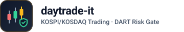

<picture>
  <source media="(prefers-color-scheme: dark)" srcset="docs/images/brand/wordmark-dark.svg">
  
</picture>

[English](README.md) | **한국어**

**코스피·코스닥 뉴스 데이트레이딩 시스템과, 그 전략에 실제 우위(edge)가 있는지 측정한 리서치 기록.**

[](https://github.com/younghwan91/daytrade-it/actions/workflows/ci.yml)
[](https://www.python.org/)
[](LICENSE)

이 시스템은 토스 뉴스와 DART 공시를 읽어 LLM(Anthropic Claude Haiku)으로 호재·악재를 판정하고, 지정가로 1주 매수 후 15:00 KST에 청산합니다. 모든 주문은 키움증권 브로커 어댑터와 공시 기반 리스크 게이트를 거치며, 시세 데이터는 형제 레포 [`quant-airflow`](https://github.com/younghwan91/quant-airflow)의 TimescaleDB에서 읽기 전용으로 조회합니다.

> **상태 — 실매매 정지.** 2026-09-17 이후 실시간 진입이 중단되었습니다(킬 스위치 `data/live_STOP`).
> 현재 데몬은 판정 기록과 페이퍼 원장만 남깁니다.
> [`docs/research/`](docs/research/README.md)의 리서치 결과, 이 방식의 뉴스 매매는 **왕복 거래비용(약 36.7 bp)을 넘는 우위가 없음**이 확인되었습니다.
> 종료된 가설, 사전 등록(pre-registration), 포워드 게이트가 해당 문서에 정리되어 있습니다. 이 저장소는 수익 전략이 아닌 리서치 기록 및 레퍼런스 구현으로 참고하세요.

## 구성 요소

| 영역 | 역할 |
|---|---|
| **리스크 게이트** (`domain/services/risk_gate.py`) | DART 공시(상장폐지, 매매거래정지, 감사의견거절, 횡령 등)를 분류해 시그널과 무관하게 진입을 차단하거나 강제 청산합니다. 뉴스 감성만으로는 진입 차단만 가능하며 강제 청산은 불가합니다. |
| **뉴스 판정** (`infrastructure/external/`) | 토스 및 DART 폴러와 프롬프트 캐싱을 적용한 Anthropic 뉴스 판정 클라이언트. |
| **시그널 및 매매** (`application/`, `scripts/news_signal_poller.py`) | 판정을 진입·청산으로 변환(1주 지정가 주문, 가격 밴드, 일일/종목별 상한, 페이퍼 모드). |
| **브로커** (`infrastructure/brokers/`) | 키움 지정가 주문 및 페이퍼/시뮬레이션 브로커. 시장가 주문 코드는 미검증 상태라 거부합니다. |
| **백테스트 / 리플레이** | 한국 시장 비용 모델로 과거 봉 데이터 위에서 라이브 매매 코드를 재현(지정 호스트에서만 실행 — `krx-quant-core` 가드). |
| **리서치** (`scripts/eval/`, `docs/research/`) | 측정 스크립트, 사전 등록(`docs/research/frozen/`), 판정 문서. |
| **인터페이스** | `gptq` CLI, FastAPI 앱, AI 에이전트용 MCP 서버(`docs/mcp/README.md`). |

시장 공통 로직(호가 단위, 비용 모델, 공시 리스크 게이트, 키움 상수)은 [`krx-quant-core`](https://github.com/younghwan91/krx-quant-core)에 있으며, 이 레포의 `risk_gate.py`, `cost_model.py`, `tick_size.py`는 얇은 재수출(re-export) 래퍼입니다.

## 아키텍처

```
src/daytrade_it/
├── domain/          # 엔티티, 값 객체, 서비스 (RiskGate, RiskManager, 비용, 호가)
├── application/     # 커맨드/쿼리/핸들러, 시그널, 트레이딩, 리플레이, 뉴스, ML
├── infrastructure/  # 외부 연동 (Toss, DART, Anthropic, quant-airflow DB), 브로커, 영속성
├── interfaces/      # api (FastAPI), cli (Typer), mcp, websocket
└── shared/          # 설정, 로깅, 에러
```

모든 주문은 `KiwoomBroker.place_order()`에 도달하기 전 `RiskManager.validate_trade()`를 통과해야 합니다. 매수 시 리스크 게이트는 최근 7일간 해당 종목의 중대 공시를 확인하며, 데이터 파일이 없거나 오래된 경우 통과시키지 않고 진입을 거부합니다.

## 빠른 시작

Python 3.12+, [uv](https://docs.astral.sh/uv/), Docker가 필요합니다.

```bash
git clone https://github.com/younghwan91/daytrade-it.git
cd daytrade-it

uv sync --extra dev
cp .env.example .env        # 본인 DB DSN 및 API 키 입력

docker compose -f docker/docker-compose.yml up -d   # TimescaleDB / Redis
uv run alembic upgrade head
uv run uvicorn daytrade_it.interfaces.api.main:app --reload   # /docs 에서 Swagger UI 확인
```

```bash
uv run gptq analyze 005930          # 6자리 KRX 종목코드
uv run gptq signals --min-confidence 0.7
uv run gptq trade --paper
```

### 환경 설정

설정은 `GPTQ_` 접두사가 붙은 환경 변수에서 읽으며, 전체 목록은 `.env.example`에 있습니다(`shared/config/settings.py`에서 정확한 필드명 확인). 키움 앱 키/시크릿, DART 키, Anthropic 키, DB DSN 등 인증 정보는 환경 변수로만 주입하며 값이 채워진 `.env`는 절대 커밋하지 마세요. `GPTQ_BROKER_TYPE`은 `paper` 또는 `kiwoom`이며 키움 모의투자 플래그는 기본 활성화되어 있습니다.

## 테스트

```bash
uv run pytest tests/unit tests/integration --no-cov -q
uv run ruff check src tests
```

`tests/integration/`의 일부 테스트는 `quant-airflow` DB 연결이 필요하며, DB가 없으면 자동으로 건너뜁니다. `tests/e2e/`는 실행 중인 API 서버(`E2E_BASE_URL`, 기본 `http://localhost:8000`)가 필요합니다.

## 문서

- [`docs/research/README.md`](docs/research/README.md) — 리서치 인덱스, 포워드 게이트, 종료된 가설
- [`docs/adr/`](docs/adr/README.md) — 아키텍처 결정 기록(ADR)
- [`docs/mcp/README.md`](docs/mcp/README.md) — MCP 도구 안내
- [`PLAN.md`](PLAN.md) — 초기 마이그레이션 계획 (이력용; 최신 상태와 다를 수 있음)

유래: 미국 주식 시스템이었던 `gpt-quant-v2`(삭제됨)를 한국 주식 시스템으로 재개발했습니다.

## 형제 레포지토리

| 레포 | 역할 |
|---|---|
| [`krx-news-client`](https://github.com/younghwan91/krx-news-client) | 토스·DART 뉴스 수집 클라이언트 라이브러리 |
| [`kiwoom-client`](https://github.com/younghwan91/kiwoom-client) | 키움증권 REST API 클라이언트 |
| [`krx-quant-core`](https://github.com/younghwan91/krx-quant-core) | KRX 시장 규칙, 비용 모델, 리스크 게이트, 실행 상수 |
| [`quant-airflow`](https://github.com/younghwan91/quant-airflow) | TimescaleDB 배치 적재 파이프라인 (여기서 읽기 전용 조회) |
| [`swing-it`](https://github.com/younghwan91/swing-it) | 코스피·코스닥 스윙 리서치 (실매매 없음) |

## 라이선스

MIT — [LICENSE](LICENSE) 참고.
