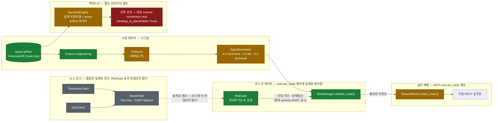

# daytrade-it

**Korean-equity (KOSPI/KOSDAQ) trading system with a news/disclosure risk gate**

A clean-architecture (DDD) trading system for Korean equities: a read-only
market-data reader over a sibling `quant-airflow` TimescaleDB, a Kiwoom
Securities broker adapter, and a risk gate that blocks entries — and
force-exits only on hard-severity DART disclosures — independent of the
ML/technical signal path.

> **Provenance.** This repository was redeveloped from
> [`gpt-quant-v2`](https://github.com/younghwan91/gpt-quant-v2) (archived),
> re-platformed from a US-equity system into a Korean-equity system across
> an 8-phase plan. The full plan, its per-phase results, and every open
> item are in [`PLAN.md`](PLAN.md) — read its "Phase 7 Results" section for
> the consolidated list of what's still open.

---

## What's real vs. still a stub

This system was built in phases, and not everything a caller can reach is
fully wired yet. Read this before trusting any number it returns.

| Component | Status |
|---|---|
| **Risk gate** (`domain/services/risk_gate.py`) | ✅ Real. Classifies DART disclosures against a researched hard-severity taxonomy (delisting, 관리종목지정, 매매거래정지, 감사의견거절, 횡령/배임, 계속기업불확실성) and blocks/force-exits independent of the ML/technical signal. Sentiment alone can only ever block new entries — never force an exit — structurally enforced and adversarially tested. Wired into `execute_trade`'s MCP tool via `RiskManager.validate_trade`, which runs before any order reaches the broker. |
| **Backtest engine** | ⚠️ Partially real. Real market data (`quant_airflow_db_client.py`, read-only off `quant-airflow`'s TimescaleDB) and a real Korean cost model (증권거래세, 위탁수수료, KOSPI/KOSDAQ tick-size-aware slippage). But the *strategy* under test is still a demo volume-momentum stub, not this system's actual signal-generation logic. `BacktestResult.strategy_is_placeholder` tells you which is which — don't read a Sharpe ratio here as validation of the news-driven strategy. |
| **News ingestion** (`toss_news_client.py` / `dart_client.py` / `news_poller.py`) | ⚠️ Built, not wired. Poll-and-dedup with a Toss-first, DART-fallback circuit breaker — fully tested — but not yet connected to the MCP tools. `get_news`/`get_price_history` raise `NotImplementedError` rather than silently serving stale US-market data. |
| **Sentiment accuracy** | ❌ Unvalidated. A Korean FinBERT checkpoint scored 60.5% accuracy / 18.2% BEARISH recall on a 76-article hand-labeled sample — not usable for a risk gate as-is. The OpenAI comparison leg is implemented but has never run (no API key available in this environment). See `PLAN.md`'s Phase 0 Results. |
| **Broker** (`kiwoom_broker.py`) | ⚠️ Unit-tested, never live. Tested against a mocked `KiwoomAPI` only — no live/mock Kiwoom credentials have ever been available here. A field-name ambiguity in `kiwoom-client` itself (its README and its examples disagree on order-request field names) is resolved by a documented best guess, flagged `TODO(verify-before-live-capital)`. Do not place real orders until that's confirmed. |
| **XGBoost model** | ❌ Not retrained. Korean feature keywords are in place; retraining needs the backtest harness (done) validated against a real strategy (not done) first. |

---

## Architecture

```
src/daytrade_it/
├── domain/           # Core business logic (no external dependencies)
│   ├── entities/          # Stock, News, Signal, Trade
│   ├── value_objects/     # Price, Volume, Ticker (6-digit KRX codes)
│   ├── services/          # SignalGenerator, RiskManager, RiskGate, TickSize, CostModel
│   └── events/            # Domain events
├── application/       # Use cases and orchestration
│   ├── commands/, queries/, handlers/
│   └── ml/                # Feature engineering, XGBoost
├── infrastructure/    # External integrations
│   ├── external/          # TossNewsClient, DartClient, NewsPoller, QuantAirflowDBClient
│   ├── brokers/            # PaperBroker, KiwoomBroker
│   └── persistence/        # TimescaleDB repositories (this system's own tables)
├── interfaces/         # Entry points
│   ├── api/                # FastAPI
│   ├── cli/                 # Typer CLI
│   ├── mcp/                 # AI-agent tool interface
│   └── websocket/           # Real-time updates
└── shared/              # Config, logging, error hierarchy
```

Data flow, as designed — colors/dashing mark actual wiring state, not intent
(see the table above for the full caveat on each component):



**범례**: 🟢 실제 배선·테스트됨 · 🟠 부분적(코드는 있으나 미검증/미완성) ·
🔴 데모 스텁 · ⚪ 개별 컴포넌트는 동작하지만 다음 단계로 이어지는 연결선이
없음(점선). 실선/점선은 코드에 그 호출·의존관계가 실제로 있는지를 뜻하지,
설계 의도를 뜻하지 않는다 — 위 색·점선 배정은 이 문서 갱신 시점(2026-09-13)
기준으로 코드를 직접 grep 해 확인한 것이다.

**실전 매매(라이브 주문) 경로.** `execute_trade` MCP 도구가 유일한 실주문
진입점이다 — `RiskManager.validate_trade()`를 거쳐야만
`KiwoomBroker.place_order()`에 도달하고, 게이트가 막으면 주문이 브로커에
아예 도달하지 않는다(이 라우팅 자체는 실배선·테스트됨). 다만 브로커 자체는
**한 번도 라이브로 실행된 적이 없다** — 모킹된 `KiwoomAPI`에 대해서만
유닛테스트됐고, 이 환경에서 라이브/모의투자 키움 자격증명이 주어진 적이
없다. `kiwoom-client`의 README와 예제가 주문요청 필드명에 대해 서로
어긋나 있는 문제는 문서화된 최선의 추정으로 임시 봉합해 뒀고
`TODO(verify-before-live-capital)`로 표시돼 있다 — **그 확인 전에는 실제
자본으로 주문을 넣지 말 것.** (참고로 이 레포가 아니라 형제 레포
`scalp-it`이 실제로 실주문을 내는 라이브 시스템이다 — 이 레포의
`execute_trade`는 설계상 그 역할을 하도록 만들어졌지만 위 이유로 아직
검증되지 않았다.)

---

## Quick start

### Prerequisites

- Python 3.12+
- Docker & Docker Compose
- [uv](https://docs.astral.sh/uv/)

### Installation

```bash
git clone https://github.com/younghwan91/daytrade-it.git
cd daytrade-it

uv venv
source .venv/bin/activate
uv pip install -e ".[dev]"

cp .env.example .env
# edit .env — see Configuration below

docker compose up -d
alembic upgrade head

uvicorn daytrade_it.interfaces.api.main:app --reload
```

### CLI

```bash
# Analyze a ticker (6-digit KRX code, e.g. 005930 = 삼성전자)
gptq analyze 005930

gptq signals --min-confidence 0.7

# Backtest — engine and cost model are real, strategy is a demo stub (see table above)
gptq backtest --start 2024-01-01 --end 2024-03-01

gptq trade --paper
```

---

## AI agent integration (MCP)

| Tool | Status |
|---|---|
| `analyze_ticker(ticker: str) -> TickerAnalysis` | 6-digit KRX code |
| `get_signals(min_confidence: float) -> list[Signal]` | live |
| `execute_trade(signal_id: str) -> TradeResult` | live — routed through `RiskManager.validate_trade` before `place_order` |
| `backtest(strategy, start, end) -> BacktestResult` | live engine, demo strategy — check `strategy_is_placeholder` |
| `get_portfolio() -> Portfolio` | live |
| `get_system_status() -> SystemStatus` | live |
| `get_news(...)` | raises `NotImplementedError` — not yet wired |
| `get_price_history(...)` | raises `NotImplementedError` — not yet wired |

### API docs

Once running: **Swagger UI** at `/docs`, **ReDoc** at `/redoc`.

---

## Testing

```bash
pytest                                              # everything
pytest --cov=src/daytrade_it --cov-report=html
pytest tests/unit/ tests/integration/ tests/e2e/    # by tier
```

The suite carries a documented, tracked baseline of 40 pre-existing failures
(stale `AAPL`/`NASDAQ`-format fixtures that predate the KRX ticker migration,
plus 3 intentionally-isolated broken handler imports) — see `PLAN.md`'s
per-phase Results sections for the history. `tests/integration/` includes a
few tests that need a reachable `quant-airflow` TimescaleDB and skip cleanly
without one.

---

## Configuration

Environment variables, `GPTQ_` prefix (see `shared/config/settings.py` for
exact field names; `.env.example` has the full list).

| Variable | Purpose |
|---|---|
| `GPTQ_DATABASE_URL` | This system's own TimescaleDB |
| `GPTQ_REDIS_URL` | Redis |
| `GPTQ_BROKER_TYPE` | `paper` or `kiwoom` |
| `GPTQ_KIWOOM_APP_KEY` / `GPTQ_KIWOOM_APP_SECRET` / `GPTQ_KIWOOM_IS_MOCK` | Kiwoom credentials (`is_mock` defaults `true`) |
| `GPTQ_KRX_NEWS__DART_API_KEY` | DART Open API key |
| `GPTQ_QUANT_AIRFLOW_DB__*` | Read-only DSN for `quant-airflow`'s TimescaleDB |
| `GPTQ_OPENAI_API_KEY` | Sentiment prompt (accuracy unvalidated — see table above) |
| ~~`GPTQ_POLYGON_API_KEY`~~ / ~~`GPTQ_TIINGO_API_KEY`~~ | Dead. Original US-market vendors; the settings classes were removed. |

---

## Risk management

- **`domain/services/risk_gate.py`** — sentiment/disclosure-driven entry blocks and hard-severity force-exits, independent of the ML/technical signal
- **`domain/services/tick_size.py`** — KRX price-band tick-size rounding, applied at Kiwoom order construction and at backtest/paper-broker fills
  (delegates the actual table to `kiwoom_client.tick_size` as of 2026-09-12 — scalp-it had the same table duplicated independently; kiwoom-client,
  the repo that actually places the order, is now the single source)
- **`domain/services/cost_model.py`** — KRX transaction costs (증권거래세 rate cited, but **not confirmed against a primary source** — treat with the same caution as the commission/slippage placeholders)
- Position sizing by account risk percentage, per-ticker position limits
- KRX trading-window enforcement (09:00–15:30 KST)
- Daily loss limits

## Sibling repositories

This system is one piece of a larger personal stack:

| Repo | Role |
|---|---|
| [`krx-news-client`](https://github.com/younghwan91/krx-news-client) | Toss/DART news scraping client library |
| [`kiwoom-client`](https://github.com/younghwan91/kiwoom-client) | Kiwoom Securities REST API client |
| `quant-airflow` | Batch ingestion (kiwoom + krx-news-client → TimescaleDB) — this system reads it read-only |
| `kr-quant` | KOSPI/KOSDAQ research, downstream of `quant-airflow`, no live trading |

---

## License

MIT — see [LICENSE](LICENSE).

## Contributing

See [CONTRIBUTING.md](CONTRIBUTING.md).
