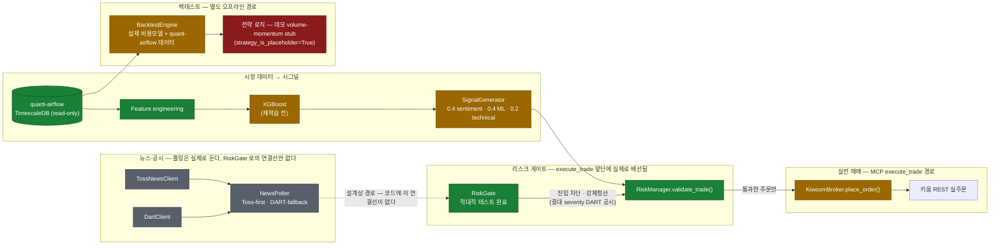

# daytrade-it

**Korean-equity (KOSPI/KOSDAQ) trading system with a news/disclosure risk gate**

A clean-architecture (DDD) trading system for Korean equities: a read-only
market-data reader over a sibling `quant-airflow` TimescaleDB, a Kiwoom
Securities broker adapter, and a risk gate that blocks entries — and
force-exits only on hard-severity DART disclosures — independent of the
ML/technical signal path.

> **Provenance.** This repository was redeveloped from
> [`gpt-quant-v2`](https://github.com/younghwan91/gpt-quant-v2) (archived),
> re-platformed from a US-equity system into a Korean-equity system across
> an 8-phase plan. The full plan, its per-phase results, and every open
> item are in [`PLAN.md`](PLAN.md) — read its "Phase 7 Results" section for
> the consolidated list of what's still open.

---

## What's real vs. still a stub

This system was built in phases, and not everything a caller can reach is
fully wired yet. Read this before trusting any number it returns.

| Component | Status |
|---|---|
| **Risk gate** (`domain/services/risk_gate.py`) | ✅ Real. Classifies DART disclosures against a researched hard-severity taxonomy (delisting, 관리종목지정, 매매거래정지, 감사의견거절, 횡령/배임, 계속기업불확실성) and blocks/force-exits independent of the ML/technical signal. Sentiment alone can only ever block new entries — never force an exit — structurally enforced and adversarially tested. Wired into `execute_trade` via `RiskManager.validate_trade`, which runs before any order reaches the broker. On a BUY, the disclosure input is the ticker's most recent hard-severity filing of the last 7 days from scalp-it's `data/dart.db` (`dart_disclosure_db.py`, refreshed every 10 minutes in session); if that file is missing or more than 30 minutes stale the entry is refused, not waved through. Trading-halt titles are judged by their stated reason, so mechanical halts (split re-listings, bonus issues, the pause after a supply-contract filing) don't block. Exits never consult it. |
| **Backtest engine** | ⚠️ Partially real. Real market data (`quant_airflow_db_client.py`, read-only off `quant-airflow`'s TimescaleDB) and a real Korean cost model (증권거래세, 위탁수수료, KOSPI/KOSDAQ tick-size-aware slippage). But the *strategy* under test is still a demo volume-momentum stub, not this system's actual signal-generation logic. `BacktestResult.strategy_is_placeholder` tells you which is which — don't read a Sharpe ratio here as validation of the news-driven strategy. |
| **News ingestion** (`toss_news_client.py` / `dart_client.py` / `news_poller.py`) | ⚠️ Built, not wired. Poll-and-dedup with a Toss-first, DART-fallback circuit breaker — fully tested — but not yet connected to the MCP tools. `get_news`/`get_price_history` raise `NotImplementedError` rather than silently serving stale US-market data. |
| **Sentiment accuracy** | ❌ Unvalidated. A Korean FinBERT checkpoint scored 60.5% accuracy / 18.2% BEARISH recall on a 76-article hand-labeled sample — not usable for a risk gate as-is. The OpenAI comparison leg is implemented but has never run (no API key available in this environment). See `PLAN.md`'s Phase 0 Results. |
| **Broker** (`kiwoom_broker.py`) | ⚠️ Limit orders only. Unit-tested against a mocked `KiwoomAPI`. The order-request field names and values (`dmst_stex_tp="KRX"`, `stk_cd`, `ord_qty`, `ord_uv`, limit `trde_tp="0"`, `org_ord_no`) were confirmed 2026-09-13 against the same TR family's 22 live fills in sibling `scalp-it` (see `kiwoom_broker.py`'s docstring and `krx_quant_core.execution.kiwoom_spec`). The **market** order code (`"03"`) is still unverified, so `execute_trade` refuses MARKET orders. |
| **XGBoost model** | ❌ Not retrained. Korean feature keywords are in place; retraining needs the backtest harness (done) validated against a real strategy (not done) first. |

---

## Architecture

```
src/daytrade_it/
├── domain/           # Core business logic (no external dependencies)
│   ├── entities/          # Stock, News, Signal, Trade
│   ├── value_objects/     # Price, Volume, Ticker (6-digit KRX codes)
│   ├── services/          # SignalGenerator, RiskManager, RiskGate, TickSize, CostModel
│   └── events/            # Domain events
├── application/       # Use cases and orchestration
│   ├── commands/, queries/, handlers/
│   └── ml/                # Feature engineering, XGBoost
├── infrastructure/    # External integrations
│   ├── external/          # TossNewsClient, DartClient, NewsPoller, QuantAirflowDBClient
│   ├── brokers/            # PaperBroker, KiwoomBroker
│   └── persistence/        # TimescaleDB repositories (this system's own tables)
├── interfaces/         # Entry points
│   ├── api/                # FastAPI
│   ├── cli/                 # Typer CLI
│   ├── mcp/                 # AI-agent tool interface
│   └── websocket/           # Real-time updates
└── shared/              # Config, logging, error hierarchy
```

Data flow, as designed — colors/dashing mark actual wiring state, not intent
(see the table above for the full caveat on each component):



**범례**: 🟢 실제 배선·테스트됨 · 🟠 부분적(코드는 있으나 미검증/미완성) ·
🔴 데모 스텁 · ⚪ 개별 컴포넌트는 동작하지만 다음 단계로 이어지는 연결선이
없음(점선). 실선/점선은 코드에 그 호출·의존관계가 실제로 있는지를 뜻하지,
설계 의도를 뜻하지 않는다 — 위 색·점선 배정은 이 문서 갱신 시점(2026-09-13)
기준으로 코드를 직접 grep 해 확인한 것이다.

**실전 매매(라이브 주문) 경로.** `execute_trade` MCP 도구가 유일한 실주문
진입점이다 — `RiskManager.validate_trade()`를 거쳐야만
`KiwoomBroker.place_order()`에 도달하고, 게이트가 막으면 주문이 브로커에
아예 도달하지 않는다(이 라우팅 자체는 실배선·테스트됨). 주문요청
필드명·값(`dmst_stex_tp="KRX"`, 지정가 `trde_tp="0"`, `org_ord_no` 등)은
2026-09-13 형제 레포 `scalp-it`의 같은 TR(`kt10000`/`kt10001`/`kt10003`) 실발주
22건(전부 `return_code == 0`)과 대조해 확인됐다 — `kiwoom-client` README와
예제가 어긋나던 문제는 README 쪽이 맞았다. **시장가 매매구분(`"03"`)은 아직
실호출로 확인되지 않았다** — 그래서 `execute_trade`는 MARKET 주문을 거부하고
지정가만 낸다.

---

## Quick start

### Prerequisites

- Python 3.12+
- Docker & Docker Compose
- [uv](https://docs.astral.sh/uv/)

### Installation

```bash
git clone https://github.com/younghwan91/daytrade-it.git
cd daytrade-it

uv venv
source .venv/bin/activate
uv pip install -e ".[dev]"

cp .env.example .env
# edit .env — see Configuration below

docker compose up -d
alembic upgrade head

uvicorn daytrade_it.interfaces.api.main:app --reload
```

### CLI

```bash
# Analyze a ticker (6-digit KRX code, e.g. 005930 = 삼성전자)
gptq analyze 005930

gptq signals --min-confidence 0.7

# Backtest — engine and cost model are real, strategy is a demo stub (see table above)
gptq backtest --start 2024-01-01 --end 2024-03-01

gptq trade --paper
```

---

## AI agent integration (MCP)

| Tool | Status |
|---|---|
| `analyze_ticker(ticker: str) -> TickerAnalysis` | 6-digit KRX code |
| `get_signals(min_confidence: float) -> list[Signal]` | live |
| `execute_trade(signal_id: str) -> TradeResult` | live — routed through `RiskManager.validate_trade` before `place_order` |
| `backtest(strategy, start, end) -> BacktestResult` | live engine, demo strategy — check `strategy_is_placeholder` |
| `get_portfolio() -> Portfolio` | live |
| `get_system_status() -> SystemStatus` | live |
| `get_news(...)` | raises `NotImplementedError` — not yet wired |
| `get_price_history(...)` | raises `NotImplementedError` — not yet wired |

### API docs

Once running: **Swagger UI** at `/docs`, **ReDoc** at `/redoc`.

---

## Testing

```bash
pytest                                              # everything
pytest --cov=src/daytrade_it --cov-report=html
pytest tests/unit/ tests/integration/ tests/e2e/    # by tier
```

There is no longer a baseline of known failures: `tests/unit/` and
`tests/integration/` are expected to pass (CI runs both; locally
`uv run --extra dev pytest tests/unit tests/integration --no-cov -q`). The old
"40 pre-existing failures" baseline is history — see `PLAN.md`'s per-phase
Results sections. `tests/integration/` includes a few
tests that need a reachable `quant-airflow` TimescaleDB and skip cleanly
without one. `tests/e2e/` needs the API server running (`E2E_BASE_URL`,
default `http://localhost:8000`).

---

## Configuration

Environment variables, `GPTQ_` prefix (see `shared/config/settings.py` for
exact field names; `.env.example` has the full list).

| Variable | Purpose |
|---|---|
| `GPTQ_DATABASE_URL` | This system's own TimescaleDB |
| `GPTQ_REDIS_URL` | Redis |
| `GPTQ_BROKER_TYPE` | `paper` or `kiwoom` |
| `GPTQ_KIWOOM_APP_KEY` / `GPTQ_KIWOOM_APP_SECRET` / `GPTQ_KIWOOM_IS_MOCK` | Kiwoom credentials (`is_mock` defaults `true`) |
| `GPTQ_KRX_NEWS__DART_API_KEY` | DART Open API key |
| `GPTQ_QUANT_AIRFLOW_DB__*` | Read-only DSN for `quant-airflow`'s TimescaleDB |
| `GPTQ_OPENAI_API_KEY` | Sentiment prompt (accuracy unvalidated — see table above) |
| ~~`GPTQ_POLYGON_API_KEY`~~ / ~~`GPTQ_TIINGO_API_KEY`~~ | Dead. Original US-market vendors; the settings classes were removed. |

---

## Risk management

- **`domain/services/risk_gate.py`** — sentiment/disclosure-driven entry blocks and hard-severity force-exits, independent of the ML/technical signal
- **`domain/services/tick_size.py`** — KRX price-band tick-size rounding, applied at Kiwoom order construction and at backtest/paper-broker fills
  (the table itself lives in `kiwoom_client.tick_size`, the repo that actually places the order)
- **`domain/services/cost_model.py`** — KRX transaction costs (증권거래세 rate cited, but **not confirmed against a primary source** — treat with the same caution as the commission/slippage placeholders)

### Shared core (`krx-quant-core`)

Market-generic logic shared with `scalp-it` lives in
[`krx-quant-core`](https://github.com/younghwan91/krx-quant-core) (pinned tag in
`pyproject.toml`): tick helpers, the cost model, the disclosure risk gate and
its `dart.db` reader, the backtest-host guard, KRX code normalization, Kiwoom
protocol constants, the KST clock, and backtest performance metrics. The
modules above (`risk_gate.py`, `cost_model.py`, `tick_size.py`,
`dart_disclosure_db.py`, `shared/runtime_host.py`) keep their import paths as
thin re-exports — change the logic in core, not here. Strategy code,
`AutoTrader` and `execute_trade` stay in this repo.

#### krx-quant-core 공용 엔진 사용 (v0.7.0)

| 쓰는 곳 | 코어 엔진 | 비고 |
|---|---|---|
| `scripts/news_signal_poller.py` | `execution.oms.InstanceLock` | `<레포>/data/auto_trader/poller.lock`(live), `--paper` 는 `<레포>/data/auto_trader_paper/poller.lock` — 같은 모드의 두 번째 poller 는 잡고 있는 pid 를 ERROR 로 남기고 exit 0 (셸 flock 도 유지) |
| `news_signal_poller.py --execute --paper` | `execution.paper.PaperBroker` | `infrastructure/brokers/core_paper_broker.py` — 시세는 실 키움(읽기), 주문은 모의 체결, 원장 `data/auto_trader_paper/`, 판정 `data/news_judgments_paper/`, 신호는 DB 에 안 씀. `--confirm-real` 과 같이 못 씀, 크론 없음 |
| `scripts/preopen_check.sh` 5b | `execution.kiwoom_broker.KiwoomBroker(dry_run=True).holdings()` | daytrade 보유와 수량 대사 — WARN 만, 종료코드 불변 |
| MCP `backtest` (`application/handlers/backtest.py`) | `backtest.replay.run_replay` + `PositionBook` | 일봉 = 15:30 KST `Bar`. 체결은 보수적 through-close 지정가(다음 종가가 뚫어야 체결) |
| `research/nightly.toml` + `deploy/crontab.simnode` | `kqc nightly .` | simnode 평일 18:30, job `mcp-backtest-smoke`(최근 20거래일 × 5종목). 로그 `~/.kqc/nightly/<날짜>/` |

실주문 경로(`AutoTrader`·`execute_trade`·`KiwoomBroker`)는 아직 코어 `OrderManager` 를 쓰지 않는다.

> ⚠️ **장중 live poller(`--paper` 없이)를 손으로 띄우지 말 것 — 실데몬이 하루 종일 쉰다(청산 포함).**
> 손으로 띄운 poller 가 `data/auto_trader/poller.lock` 을 잡고 있으면 크론 데몬의 재시작이 전부 잠금에서 끝난다
> (`data/news_signal_daemon.log` 에 `holder_pid` 가 찍힌 ERROR).
> `--paper` 는 잠금이 따로(`data/auto_trader_paper/poller.lock`)라 실데몬과 독립이지만, 판정마다 Claude 를 불러
> 실데몬과 같은 Anthropic 크레딧을 쓴다.

- Position sizing by account risk percentage, per-ticker position limits
- KRX trading-window enforcement (09:00–15:30 KST)
- Daily loss limits

## Sibling repositories

This system is one piece of a larger personal stack:

| Repo | Role |
|---|---|
| [`krx-news-client`](https://github.com/younghwan91/krx-news-client) | Toss/DART news scraping client library |
| [`kiwoom-client`](https://github.com/younghwan91/kiwoom-client) | Kiwoom Securities REST API client |
| [`krx-quant-core`](https://github.com/younghwan91/krx-quant-core) | KRX market rules, costs, risk gate, execution constants — shared with `scalp-it` |
| [`quant-airflow`](https://github.com/younghwan91/quant-airflow) | Batch ingestion (kiwoom + krx-news-client → TimescaleDB) — this system reads it read-only |
| [`swing-it`](https://github.com/younghwan91/swing-it) | KOSPI/KOSDAQ research, downstream of `quant-airflow`, no live trading |

---

## License

MIT — see [LICENSE](LICENSE).

## Contributing

See [CONTRIBUTING.md](CONTRIBUTING.md).
